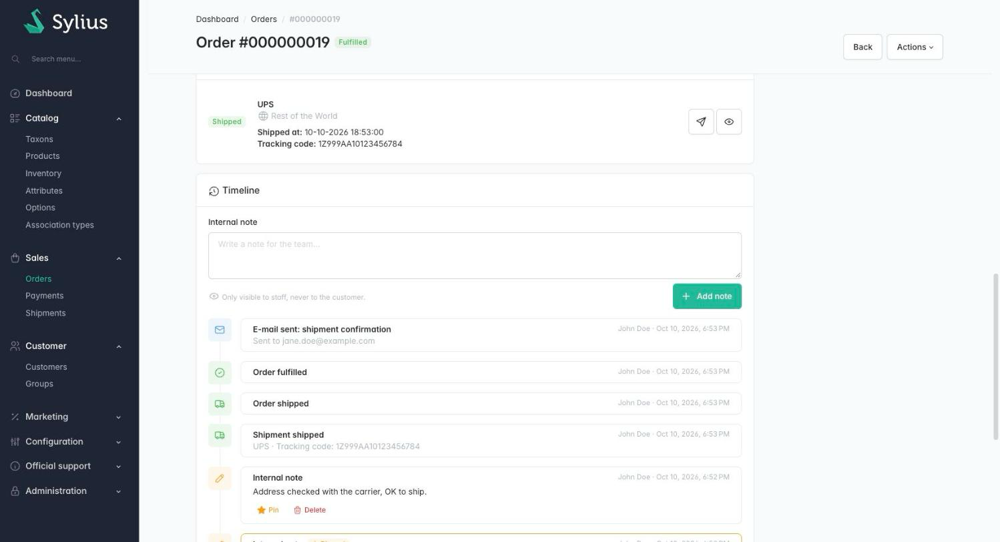
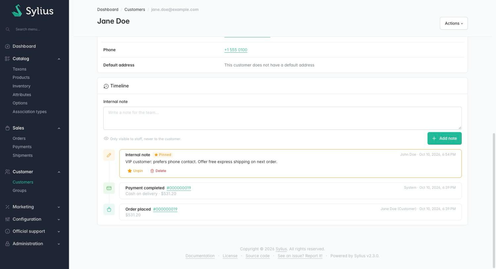

# Sylius Timeline Plugin

> English: [README.md](README.md) <!-- vitrine:lang -->

[](https://github.com/thibmonier/sylius-timeline-plugin/actions/workflows/build.yaml)
[](LICENSE)

**Une chronologie des commandes et des clients, avec des notes internes de l'équipe, pour le back-office de Sylius 2.**

La page d'une commande Sylius 2 n'a pas d'historique : la page « History » ne liste que les
changements d'adresse, la note du client saisie au tunnel de commande est en lecture seule, et
l'équipe ne peut pas laisser de note sur une commande ou sur un client. Les plugins Sylius 1 qui
le faisaient n'ont jamais été portés.

Ce plugin enregistre ce qui arrive à une commande (passée, payée, expédiée, annulée, remboursée,
e-mails envoyés) et permet à l'équipe de rédiger des notes internes, gratuit et open source.

## Fonctionnalités

| Besoin | Ce que fait le plugin |
|---|---|
| Savoir ce qui est arrivé à une commande, et qui l'a fait | **Carte Chronologie** sur la page de commande de l'administration, de la plus récente à la plus ancienne : commande passée, changements d'état de la commande / du paiement / de l'expédition, chaque paiement (moyen + montant) et chaque envoi (méthode + code de suivi), e-mails envoyés (avec leurs destinataires). Chaque entrée affiche une icône, un libellé, l'auteur (nom de l'administrateur, *Client* ou *Système*) et la date. |
| Voir la note du client dans son contexte | La note saisie au tunnel de commande devient une entrée *Note du client* à l'instant où la commande a été passée. |
| Partager l'information au sein de l'équipe | **Notes internes** sur les commandes et sur les clients : texte brut jusqu'à 5 000 caractères, retours à la ligne conservés, HTML échappé. Jamais affichées dans la boutique. |
| Garder l'information importante sous les yeux | **Épinglez** une note : les notes épinglées s'affichent en haut de la page de la commande ou du client, dans une carte mise en évidence. |
| Connaître le client | **Chronologie du client** sur la page client de l'administration : notes du client et événements clés de ses commandes (passée avec numéro et total, annulée, paiements effectués ou remboursés), 50 dernières entrées avec un lien vers la page complète paginée. |
| Repérer les commandes qui demandent de l'attention | **Pastille de notes** indiquant le nombre de notes internes dans la grille des commandes de l'administration. |
| Installer sur une boutique en production | `tmonier:timeline:backfill` reconstitue une chronologie pour les commandes existantes. |

Également inclus : traductions en anglais, français, allemand, espagnol, italien, néerlandais et polonais ;
Twig Hooks partout ; prise en charge de MySQL, MariaDB et PostgreSQL.

## Captures d'écran





## Prérequis

| | Version |
|---|---|
| PHP | 8.2+ |
| Sylius | 2.2, 2.3 |
| Symfony | 6.4, 7.4, 8.0 |

L'abstraction de machine à états doit utiliser l'adaptateur **Symfony Workflow** (celui par défaut de Sylius 2,
`sylius_state_machine_abstraction.default_adapter: symfony_workflow`). Les graphes associés à
l'adaptateur Winzou ne déclenchent pas les événements de Symfony Workflow et ne sont pas enregistrés.

## Installation

1. Ajoutez le paquet :

    ```bash
    composer require tmonier/sylius-timeline-plugin
    ```

2. Enregistrez le bundle dans `config/bundles.php` (Symfony Flex le fait automatiquement dès qu'une recipe existe) :

    ```php
    Tmonier\SyliusTimelinePlugin\TmonierSyliusTimelinePlugin::class => ['all' => true],
    ```

3. Importez la configuration dans `config/packages/tmonier_sylius_timeline.yaml` :

    ```yaml
    imports:
        - { resource: "@TmonierSyliusTimelinePlugin/config/config.yaml" }
    ```

4. Importez les routes de l'administration dans `config/routes/tmonier_sylius_timeline.yaml` :

    ```yaml
    tmonier_sylius_timeline:
        resource: "@TmonierSyliusTimelinePlugin/config/routes.yaml"
    ```

5. Exécutez les migrations :

    ```bash
    bin/console doctrine:migrations:migrate
    ```

6. Facultatif : donnez une chronologie aux commandes passées avant l'installation :

    ```bash
    bin/console tmonier:timeline:backfill --dry-run
    bin/console tmonier:timeline:backfill
    ```

## Configuration

```yaml
# config/packages/tmonier_sylius_timeline.yaml
tmonier_sylius_timeline:
    record_emails: true          # e-mails sent by the Sylius mailer about an order
    enabled_workflows:           # default value
        - sylius_order
        - sylius_order_payment
        - sylius_order_shipping
        - sylius_payment
        - sylius_shipment
```

`enabled_workflows` accepte tout workflow Symfony dont le sujet est une commande, un paiement ou une
expédition ; vos propres workflows peuvent donc aussi être enregistrés (ils reçoivent un libellé générique, ou votre propre
traduction `tmonier_timeline.event.<workflow>.<transition>`). Les transitions de gestion interne
appliquées pendant qu'une commande est passée (`request_payment`, `request_shipping`, `create` et
`process` du paiement, `create` de l'expédition) ne sont jamais enregistrées, pas plus que tout ce qui arrive à un panier.

La ressource `TimelineEntry` peut être étendue comme n'importe quelle ressource Sylius
(`tmonier_sylius_timeline.resources.timeline_entry.classes.model`).

Pour masquer la colonne des notes de la grille des commandes :

```yaml
sylius_grid:
    grids:
        sylius_admin_order:
            fields:
                tmonier_timeline_notes:
                    enabled: false
```

## Personnalisation

Les parties de l'administration sont construites avec [Twig Hooks](https://stack.sylius.com/twig-hooks/getting-started) :

| Hook | Contenu |
|---|---|
| `sylius_admin.order.show.content.sections#left` → `tmonier_timeline_pinned_notes` | Notes épinglées (haut de la page de la commande) |
| `sylius_admin.order.show.content.sections#left` → `tmonier_timeline` | Carte Chronologie (bas de la page de la commande) |
| `sylius_admin.order.show.content.sections.tmonier_timeline` → `note_form`, `entries` | Formulaire de note et entrées de la chronologie de la commande |
| `sylius_admin.customer.show.content.sections` → `tmonier_timeline_pinned_notes` | Notes épinglées (haut de la page du client) |
| `sylius_admin.customer.show.content.sections` → `tmonier_timeline` | Carte Chronologie (bas de la page du client) |
| `sylius_admin.customer.show.content.sections.tmonier_timeline` → `note_form`, `entries` | Formulaire de note et entrées (`configuration.limit`, 50 par défaut) |
| `tmonier_timeline.admin.customer.timeline` | Page complète de la chronologie du client |

Les templates peuvent être surchargés dans `templates/bundles/TmonierSyliusTimelinePlugin/`. Pour enregistrer
vos propres événements, utilisez les services :

```php
public function __construct(
    private TimelineEntryFactoryInterface $entryFactory,
    private TimelineEntryWriterInterface $writer,
) {}

$entry = $this->entryFactory->createForOrder($order, TimelineEntryInterface::TYPE_TRANSITION, Actor::system());
$entry->setWorkflow('app_fraud_check');
$entry->setTransition('flag');
$this->writer->persist($entry); // flushed with your own changes
```

## Comment les événements sont enregistrés

- **Transitions de workflow** : un listener sur `workflow.completed` enregistre les transitions des
  workflows configurés. L'entrée est persistée **sans flush** ; elle est donc sauvegardée par le flush
  qui sauvegarde le changement d'état lui-même, dans la même transaction (et pas du tout si ce changement
  est annulé). Lorsque la commande n'est pas encore persistée (fixtures, imports), l'entrée attend
  le flush qui insère la commande.
- **E-mails** : un listener sur `sylius.email_send.post_send` enregistre les e-mails dont les données contiennent
  une `order` (ou une `shipment` / `payment` d'une commande). Les e-mails sont envoyés après le flush
  de l'application ; l'entrée est donc flushée immédiatement, mais seulement quand rien d'autre n'est en attente dans l'unit of work ;
  sinon elle attend le prochain flush de l'application.
- **Auteurs** : l'administrateur authentifié (son nom est conservé en instantané lorsque le compte est
  supprimé), *Client* pour les utilisateurs de la boutique et les commandes passées par des invités, *Système* dans les autres cas
  (console, consommateurs de messages, notifications de paiement).
- **Les échecs ne cassent jamais un tunnel de commande** : les erreurs d'enregistrement sont interceptées et journalisées sur
  le canal `tmonier_timeline`.

## Règles des notes

- Les notes sont en texte brut (le HTML est échappé, les retours à la ligne sont conservés), 5 000 caractères au maximum.
- Tout administrateur peut ajouter, épingler et désépingler des notes.
- Seul l'**auteur** peut supprimer une note. Lorsque le compte administrateur de l'auteur a été supprimé,
  tout administrateur le peut.
- Les notes ne peuvent pas être modifiées : supprimez-la et rédigez-en une nouvelle.
- Chaque action est un POST protégé par un jeton CSRF.

## RGPD — Données personnelles et effacement du client

### Données stockées

Le plugin stocke les données personnelles suivantes dans `tmonier_timeline_entry` :

| Champ | Où | Quoi |
|---|---|---|
| `context.recipients` | Entrées `TYPE_EMAIL` | Adresses e-mail des destinataires de chaque e-mail lié à une commande |
| `author_name` | `TYPE_ORDER_PLACED`, `TYPE_CUSTOMER_NOTE` | Instantané du nom complet du client au moment de l'événement |
| `content` | `TYPE_CUSTOMER_NOTE` | Note laissée par le client au tunnel de commande (telle quelle depuis `Order::$notes`) |

Les notes de l'équipe (`TYPE_NOTE`) sont rédigées par les administrateurs et ne sont **pas** considérées comme des données
personnelles du client. Leur `content` n'est pas effacé.

Lorsqu'un client est **supprimé**, toutes ses entrées sont supprimées par `ON DELETE CASCADE` sur
`customer_id`. Lorsqu'un client est **anonymisé** (l'entité est conservée, les données personnelles remplacées), les
entrées doivent être effacées séparément — voir ci-dessous.

### Droit à l'effacement

Utilisez `CustomerTimelineEraserInterface` pour effacer les données personnelles du client de la chronologie.
L'effaceur nettoie en une seule requête et un seul flush, sans toucher aux données métier (type
d'entrée, transition, date, numéro de commande, montants, code d'e-mail, etc.) :

```php
use Tmonier\SyliusTimelinePlugin\Gdpr\CustomerTimelineEraserInterface;

final class AnonymiseCustomerHandler
{
    public function __construct(
        private CustomerTimelineEraserInterface $timelineEraser,
        // … your other services
    ) {}

    public function __invoke(AnonymiseCustomer $command): void
    {
        $customer = $this->findCustomer($command->customerId);

        // 1. Your existing anonymisation logic (replace e-mail, name, address…).
        $this->customerAnonymiser->anonymise($customer);

        // 2. Erase personal data from the timeline.
        $this->timelineEraser->eraseForCustomer($customer);
    }
}
```

### Cœur de Sylius — point d'accroche d'anonymisation

Sylius 2.2 / 2.3 ne fournit **pas** d'événement ni de service d'anonymisation intégré
(`CustomerAnonymizer`, `sylius.customer.anonymise`, etc.). Il n'existe aucun point d'accroche automatique auquel
rattacher l'effaceur. Vous devez appeler explicitement `CustomerTimelineEraserInterface::eraseForCustomer()`
depuis votre propre processus d'anonymisation (commande, message handler, contrôleur…).

### Commande console

```bash
# Preview (no write)
bin/console tmonier:timeline:erase-customer 42 --dry-run
bin/console tmonier:timeline:erase-customer jane@example.com --dry-run

# Erase
bin/console tmonier:timeline:erase-customer 42
bin/console tmonier:timeline:erase-customer jane@example.com
```

La commande accepte soit un identifiant client numérique, soit une adresse e-mail.

## Limitations connues

- Les changements effectués en dehors de Symfony Workflow (SQL direct, graphes associés à Winzou, setters sans
  transition) ne sont pas enregistrés. Les changements d'adresse restent dans la page « History » de Sylius.
- Le backfill ne peut reconstituer que ce qu'une commande indique encore : la passation (avec la note du client
  au tunnel de commande), les paiements effectués, les envois expédiés et l'annulation. Les dates des paiements
  et des annulations sont approximées à partir de `updatedAt`.
- Les entrées enregistrent des faits avec un instantané (nom du moyen de paiement, montant, code de suivi) ; elles ne
  sont pas mises à jour lorsque la commande est modifiée par la suite.
- Le RBAC de Sylius Plus n'est pas intégré : tout administrateur peut voir et écrire des notes.

## Développement

```bash
docker compose up -d mysql   # or your own MySQL
composer install
(cd vendor/sylius/test-application && yarn install && yarn build)
vendor/bin/console doctrine:database:create
vendor/bin/console doctrine:migrations:migrate -n
vendor/bin/console sylius:fixtures:load -n

vendor/bin/phpunit --testsuite unit
APP_ENV=test vendor/bin/phpunit --testsuite non-unit   # needs a test database with fixtures
vendor/bin/phpstan analyse
vendor/bin/ecs check
```

<!-- vitrine:demo-b2b:start -->
## Démo B2B

Ce plugin est utilisé dans la [démo B2B Sylius](https://github.com/thibmonier/sylius-b2b-demo) : une boutique Sylius 2.3 avec des données d'exemple fictives, où les plugins B2B fonctionnent ensemble. Le code source, l'installation et les fixtures de la démo sont dans ce dépôt.

La démo est un exemple, pas une configuration de production.
<!-- vitrine:demo-b2b:end -->

## Licence

MIT. Voir [LICENSE](LICENSE).
